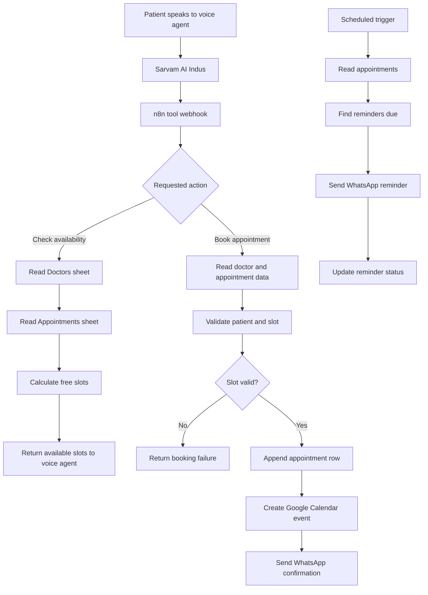

# AI Healthcare Voice Receptionist

A voice-enabled appointment receptionist workflow built with **Sarvam AI Indus + n8n**, using Google Sheets for doctor schedules and appointment records, Google Calendar for appointment events, and WhatsApp for booking confirmations and reminders.

> **Project status:** Working prototype / in progress. The supplied n8n export shows the workflow structure and integrations. This public repository is a sanitized, documentation-first project package. The exported workflow has not been independently executed in this environment.

## What it does

- Checks doctor availability for a requested date.
- Reads doctor schedules and existing booked appointments from Google Sheets.
- Calculates free appointment slots and filters out past slots for the current day (IST logic is present in the workflow).
- Validates booking details and checks that the requested slot is still available.
- Writes a confirmed appointment to the appointments sheet.
- Creates a Google Calendar event.
- Sends a WhatsApp booking confirmation.
- Runs a scheduled reminder check every 10 minutes during the configured 08:00–19:00 window; the workflow selects appointments approximately 50–65 minutes away and marks a reminder as sent after a successful WhatsApp API response.

## Architecture



## Technology

- Sarvam AI Indus — voice-agent platform (voice interface)
- n8n — workflow orchestration and tool webhooks
- Google Sheets — doctor schedules and appointment records
- Google Calendar — calendar event creation
- WhatsApp Cloud API — confirmation and reminder messages
- JavaScript — slot calculation, input validation, and workflow transformations

## Repository layout

```text
ai-healthcare-voice-receptionist/
├── README.md
├── LICENSE
├── .gitignore
├── workflow/
│   └── hospital-receptionist-sanitized.json
├── docs/
│   ├── architecture.md
│   ├── setup.md
│   ├── data-model.md
│   ├── testing-checklist.md
│   └── privacy-and-safety.md
└── examples/
    ├── check-availability.json
    └── book-appointment.json
```

## Workflow export

The sanitized n8n workflow is in [`workflow/hospital-receptionist-sanitized.json`](workflow/hospital-receptionist-sanitized.json).

Before importing it, read [the setup guide](docs/setup.md). You must reconnect your own Google Sheets, Google Calendar, and WhatsApp credentials and replace the placeholder resource IDs. Never commit credentials, real patient data, production webhook URLs, or private clinic information.

## Important limitations

- This is an appointment-administration prototype, not a medical diagnosis or triage system.
- It does not replace a human receptionist or clinician.
- The workflow export is inactive and has had credential references removed for safety.
- WhatsApp template names and approved message templates must match the configuration in your own WhatsApp Business account.
- Confirm the actual Indus tool schema and webhook request/response contract in your Indus agent configuration before connecting it.
- The repository does not include real patient records, live credentials, or a production database.

## Next improvements

- Add stronger protection against simultaneous bookings (atomic slot locking).
- Add idempotency keys to prevent duplicate bookings on webhook retries.
- Add cancellation and rescheduling flows with audit history.
- Add authentication/signature verification for incoming webhooks.
- Add structured error handling and monitoring for calendar and WhatsApp failures.
- Add automated tests for date, time, slot, and duplicate-booking edge cases.

## Author

**Abinaya V.** — WordPress Developer exploring workflow automation and applied AI integrations.

This project is presented as an individual portfolio project. Any employer/client-owned systems, credentials, data, or proprietary assets should remain private.
